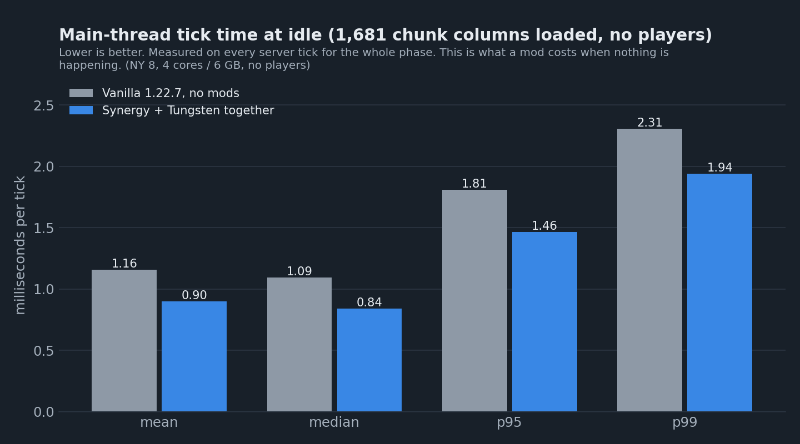
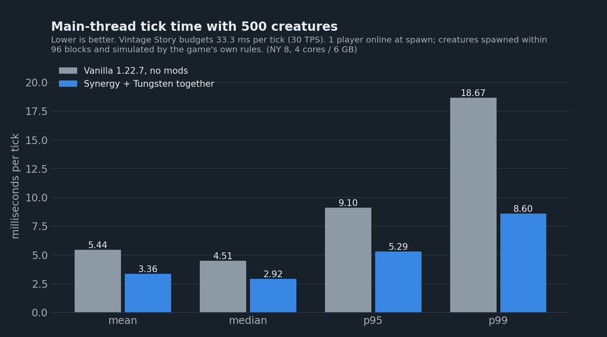
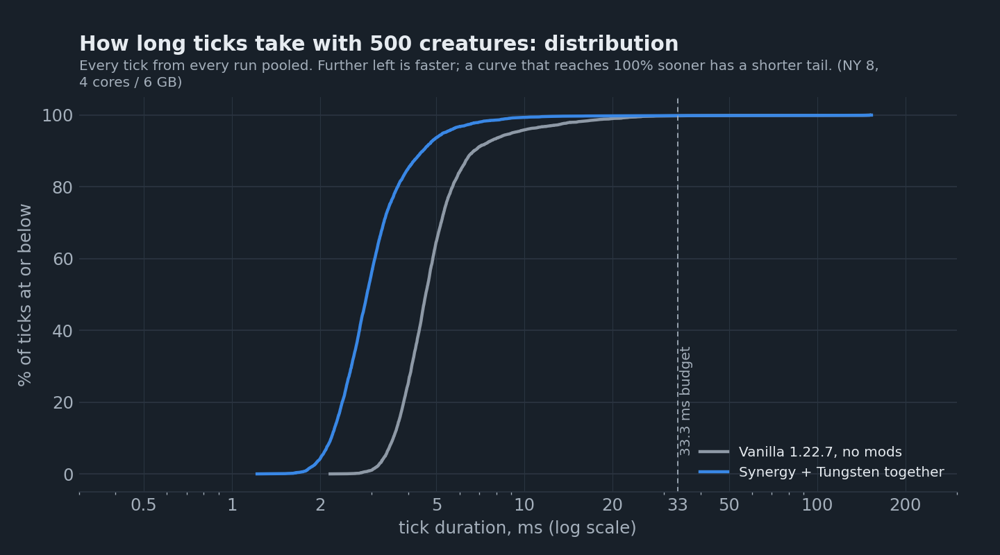

# Synergy and Tungsten on a Vintage Story Server: We Benchmarked Both, Alone and Together (1.22.7)

Synergy and Tungsten are the two server-side performance mods most Vintage Story server owners end up asking about. Both are by the same author and designed to run together, and both make numbers-heavy claims: Synergy promises a 15 to 40% tick-time reduction, Tungsten 30 to 40% less garbage-collection pause. We run a lot of Vintage Story servers, so we wanted to know what they actually do on the kind of server our customers rent. We benchmarked the unmodded 1.22.7 server, each mod on its own, and both together, inside an ordinary 4-core, 6 GB game server on one of our production nodes, with other customers' servers running alongside. We did it twice: once on an empty server, and once with a player online, because it turns out that matters a great deal for one of them. This is what we found.

## The short version

- **With a player online, Synergy cuts the tick under creature load by 38% and the lag spikes in half.** With 500 creatures around one player the mean tick fell from 5.44 ms to 3.36 ms, the 99th-percentile tick from 18.7 ms to 9.1 ms, and time paused for garbage collection by 39%.
- **Most of that is Synergy doing less, by design.** Its headline feature puts every creature more than 48 blocks from a player to sleep; the unmodded game simulates them out to 128 blocks. In our test that put about 440 of the 500 creatures to sleep and throttled the AI of the rest. That is a gameplay trade, not a free lunch, and you can turn it off. We did: with the activation range disabled, Synergy's gain on the mean tick fell from 23% to 5% in that pass, and its AI throttle was still at work.
- **Tungsten is a pure optimisation and it shows up only with a player online: 14% off the mean tick, no change to what the game does.** On an empty server its tick-time effect was zero.
- **Together they are no better than Synergy alone.** Both together: 38% off the mean tick, 54% off the 99th percentile, within noise of Synergy by itself. Once Synergy has stopped simulating most creatures, the work Tungsten optimises is mostly gone. They did not fight either: no crash, no error, and Tungsten's own conflict check flagged the one method both patch and carried on.
- **On an empty server, Synergy still trims the idle tick by a quarter** (1.16 ms to 0.87 ms), because it skips the game's sleeping wild animals entirely when nobody is online. Tungsten changed nothing there.
- **Startup, world generation and memory did not change.** Details at the end.

If you run a public server with players spread across the map, install Synergy and expect a markedly smoother server, with the knowledge that creatures far from players are being put on ice. If you want the game simulated exactly as vanilla does it, Tungsten is the one to install; it is smaller, but it is free. Running both gains you nothing measurable over Synergy alone, but costs nothing either.

## The mods

| Mod | Version tested | Author | Mod DB |
|---|---|---|---|
| Synergy | 1.1.25 | Zaldaryon | [synergy](https://mods.vintagestory.at/synergy) |
| Tungsten | 1.3.7 | Zaldaryon | [tungsten](https://mods.vintagestory.at/tungsten) |

Both are server-only: players keep using the normal client, and both work by patching the server's code at startup rather than replacing files. Both are the newest releases on the mod database at the time of the run. They are tagged for 1.22.6 and loaded on 1.22.7 without complaint; Tungsten reports all 26 of its optimisations enabled, Synergy 13 active (network flush consolidation is off by default, and the delta-encoding features need the companion client mod to do anything). Both ran with their default configuration unless stated otherwise.

**Synergy** describes itself as "coordinated server-side performance and fluidity optimizations". Its server-side list: an *entity activation range* that skips ticking creatures more than 48 blocks from any player (a whitelist of behaviours such as breathing, health and growth keeps running), distance-based throttles for AI decisions, pathfinding and entity repulsion, a collision fast path for stationary entities, pooled buffers for block ticks and pathfinding, an inventory dirty-scan, an auto-save optimisation, and a garbage-collector mode that suppresses blocking full collections. Every optimisation is a switch in its config file.

**Tungsten** is "server-side only performance optimization". Its 26 optimisations are the unglamorous kind: reusing lists instead of allocating them in entity ticking, block operations, drops and events; faster chunk loading and unloading; LINQ removed from hot paths in player queries, recipes and broadcasts; frozen class registries; and three world-generation changes (zero-allocation terrain noise, a bit-array rewrite and native noise code). None of them changes what the game simulates.

## How we tested

The benchmark server is an ordinary game server on one of our nodes (NY 8, Ryzen 9 9950X, 4 cores and 6 GB allocated to the server) running the official Vintage Story 1.22.7 dedicated server. A small server-side mod of our own drives the test, so every run is identical:

1. **Startup** is timed from process launch until the server reports it is running the game, on a fresh world with a fixed seed.
2. **World generation**: the mod requests 1,681 chunk columns (13,448 chunks) around spawn and waits until every one is loaded.
3. **Idle**: twenty seconds of nothing, every tick measured.
4. **Creatures**: 500 creatures (wolves, drifters, deer, foxes, hares) are spawned and ticks are measured for 45 seconds.
5. The mod writes its results and shuts the server down. A second run restarts on the same world and times reloading it from disk.

We ran that twice, with one difference:

- **Empty server.** No player connected. The spawned creatures are flagged always-active so every server simulates all 500, as in our [Stratum benchmark](https://github.com/Something-Unique-Hosting/vintagestory-stratum-benchmark). This is the clean, like-for-like comparison.
- **One player online.** A headless client of our own joins each server before the test starts and stands at spawn. Creatures are spawned within 96 blocks of it and left to the game's own rules: vanilla simulates a creature while it is within 128 blocks of a player. This is the realistic case, and the only one in which Synergy's distance-based features do anything.

Each mod set was run four times per scenario on a fresh world, order alternating between rounds so that noise on the node hits every set equally. Every figure below is the median of the four. Ticks are timed with a hook around the server's main loop, so the figures exclude the sleep between ticks. The charts show vanilla against both mods together; the tables list each mod on its own as well.

## Empty server

Nothing connected; every spawned creature forced active. This is the fairest possible comparison and the least flattering to Synergy.

| Idle, no players | Vanilla 1.22.7 | Synergy | Tungsten | Both |
|---|---|---|---|---|
| Mean tick | 1.16 ms | 0.87 ms (-25%) | 1.16 ms | 0.90 ms (-22%) |
| 99th percentile | 2.31 ms | 2.10 ms (-9%) | 2.29 ms | 1.94 ms (-16%) |
| Process CPU, % of one core | 4.5% | 3.7% (-19%) | 4.5% | 3.8% (-16%) |

**Synergy's quarter off the idle tick comes from the wild animals.** About 1,100 animals spawn naturally in the loaded area. With nobody online the unmodded server keeps them in its inactive state, but still spends 0.65 ms per tick in entity simulation on them; Synergy skips sleeping entities entirely when no player is connected, and that cost drops to 0.27 ms. That is a real saving on a server that sits empty most of the day, worth about 0.8% of a core. Tungsten does nothing at idle, which is what its description says.

**With 500 creatures forced active, the mods are worth a few percent.** Synergy took the mean tick from 3.88 ms to 3.67 ms (-5%), both together to 3.58 ms (-8%); Tungsten alone was within noise. The tail did not move in any direction we can stand behind: across the four vanilla runs alone the 99th-percentile tick ranged from 8 to 19 ms, and the mods' runs fell inside that spread. The worst single tick in every run is the spawn itself.

## One player online

Now the realistic case. A player stands at spawn, 500 creatures are spawned within 96 blocks of them, and the game decides what to simulate: everything within 128 blocks. That is 1,500 loaded entities including the wild animals, with around 450 of them active on the unmodded server.

| Idle, one player | Vanilla 1.22.7 | Synergy | Tungsten | Both |
|---|---|---|---|---|
| Mean tick | 1.62 ms | 1.35 ms (-17%) | 1.52 ms (-7%) | 1.38 ms (-15%) |
| 99th percentile | 5.90 ms | 4.70 ms (-20%) | 4.95 ms (-16%) | 4.24 ms (-28%) |
| GC pause over the 20 s | 67 ms | 50 ms | 55 ms | 41 ms |

A connected player costs the unmodded server about half a millisecond per tick on its own (chunk sending, tracking, position packets). Both mods claw some of it back; Tungsten now registers, because several of its optimisations live in exactly the player-related queries that an empty server never calls.

| 500 creatures, one player | Vanilla 1.22.7 | Synergy | Tungsten | Both |
|---|---|---|---|---|
| Mean tick | 5.44 ms | 3.36 ms (-38%) | 4.67 ms (-14%) | 3.36 ms (-38%) |
| Median | 4.51 ms | 2.89 ms (-36%) | 3.99 ms (-12%) | 2.92 ms (-35%) |
| 95th percentile | 9.10 ms | 5.24 ms (-42%) | 7.95 ms (-13%) | 5.29 ms (-42%) |
| 99th percentile | 18.7 ms | 9.1 ms (-51%) | 17.7 ms (-5%) | 8.6 ms (-54%) |
| Process CPU, % of one core | 23% | 15% | 20% | 14% |
| GC pause over the 45 s | 345 ms | 210 ms (-39%) | 333 ms | 198 ms (-43%) |
| Gen-0 collections | 82 | 53 | 80 | 54 |

**Synergy's numbers here are large, and they are mostly the activation range.** Synergy prints its own statistics while running, and during this phase they read, run after run, roughly "60 active, 1,450 sleeping, 60% AI throttled". Of the 500 creatures we spawned, about 60 were inside the 48-block radius and got a full simulation; the other 440 were asleep, with only the whitelisted behaviours running, and the AI of the ones still awake ran at reduced frequency the further away they stood. The unmodded server simulated all of them. Per-system timing agrees: entity simulation fell from 2.81 ms to 1.47 ms per tick, and the game-tick listeners (which include the physics and AI drivers) from 2.60 ms to 1.90 ms.

Whether that is acceptable is a gameplay question, not a performance one. A wolf 80 blocks from the nearest player stops hunting; a drifter stops wandering towards your base; animals in a far pasture stop moving until someone comes within 48 blocks. Synergy exempts entities in lava, fire or water and lets you exclude entity codes, and all of it can be switched off in its config. We measured that configuration too:

| 500 creatures, one player (separate pass, 3 rounds) | Vanilla 1.22.7 | Synergy, defaults | Synergy, activation range off |
|---|---|---|---|
| Mean tick | 6.75 ms | 5.19 ms (-23%) | 6.40 ms (-5%) |
| 95th percentile | 10.4 ms | 6.9 ms (-34%) | 9.9 ms (-5%) |
| 99th percentile | 19.6 ms | 10.4 ms (-47%) | 17.6 ms (-10%) |
| GC pause over the 45 s | 356 ms | 207 ms (-42%) | 286 ms (-20%) |
| Creatures Synergy reports asleep | n/a | about 440 | 0 |

This pass's vanilla figure is higher than the main pass's (6.75 ms against 5.44 ms). The host was equally idle both times, so that gap is run-to-run variation in what the creatures were doing, not the machine; the section on caveats has the numbers. Compare within the row. **Switch the activation range off and three quarters of Synergy's gain goes with it.** The mean tick improvement drops from 23% to 5% and the tail improvement from 47% to 10%, while Synergy's own statistics go from "440 sleeping" to "0 sleeping". What remains is still not quite free: its AI throttle is a separate switch and was still active, reporting 86 to 92% of AI decisions throttled by distance. Only the garbage-collector mode, the collision fast path and the pooled buffers are optimisations in the strict sense, and together they are worth a few percent of tick time and a fifth of the GC pause.

**Tungsten's 14% is the kind of gain you can take without reading the fine print.** Nothing is simulated less; the same entity ticks simply allocate and search less. Its distribution curve is a parallel shift of vanilla's rather than a different shape, which is what an across-the-board optimisation looks like.

**Together is Synergy.** The pair's mean tick, 95th and 99th percentiles are all within noise of Synergy alone. Adding Tungsten's 14% and Synergy's 38% would predict 2.85 ms off the mean tick; the pair measured 2.07 ms, the same as Synergy. Tungsten optimises the ticking of entities that Synergy has mostly stopped ticking. The logs show both mods patching the same entity-tick method; Tungsten noticed and reported it as a potential conflict, then applied its patch anyway, and nothing broke in sixteen runs.

**Garbage collection is where Synergy's second real optimisation lives.** Its sustained-low-latency GC mode and pooled pathfinding nodes cut the number of gen-0 collections during the creature phase from 82 to 53 and the time paused for collection by 39%, with the same single full collection in every run. On an empty server this effect was invisible; it needs the allocation churn a player brings.

## What did not change

We measured these in every pass and none of them moved beyond run-to-run noise, so they get a paragraph instead of a chart:

- **Startup**: 15.9 s on a fresh world for vanilla, every mod set within 0.6 s of it; 10.3 s on an existing world, every set within 0.8 s.
- **World generation**: 39.0 s for 1,681 columns on vanilla, every set within 0.5 s. Tungsten's terrain changes cut gen-0 garbage collections during generation by a quarter (351 to 266) and GC pause by 5%, which did not reach the wall clock because 1.22.7's worldgen is bound by CPU work, not allocation.
- **Reloading the world from disk**: 1.5 to 1.7 s in every set.
- **Memory**: peak working set 1,763 MB on vanilla without a player and 1,837 MB with one; every set within 50 MB of that. Managed heap after the creature phase within 30 MB.
- **Forced-active creature ladder**: with no player and every creature forced active, spawned in steps up to 10,000, all four servers sat on the same curve. Neither mod makes simulating a creature cheaper, so that pass is left out.
- **Tick rate**: every set held 29.8 ticks per second in every 500-creature test. The mods change how long the tick takes inside the budget, not whether the server keeps up at this load.

## Verdict

- **Synergy** is the one that changes how a busy server feels, and the one you should understand before installing. With its defaults it stops simulating creatures that are 48 to 128 blocks from every player and throttles the AI of the rest, and that is where most of its 38% comes from. If you are fine with distant creatures freezing, and on a public server with players scattered across a continent most owners will be, it is the largest improvement available short of changing servers. Its garbage-collector mode and idle-server savings are real and come without that trade; with the activation range switched off, expect a few percent on the tick and a fifth less GC pause, not the headline figures.
- **Tungsten** is safe to install on any server and worth 14% off the busy tick with a player online, and a quarter fewer collections during world generation. It does nothing you will notice on an empty server, and nothing you will notice if you also run Synergy.
- **Both together** work, and cost nothing, but measured no better than Synergy alone on our server.
- **Neither** affects memory, world generation speed, or startup in any way that matters.

## Caveats

- One player, standing still. Nothing a mod does per player (packets, inventories, delta encoding) scales up in this test, and Synergy's bandwidth features were not measured at all.
- Creatures within 96 blocks of one spot is a dense herd, which flatters anything that throttles by distance. A server with players spread out will see smaller absolute gains from Synergy's activation range and the same mechanism at work.
- The empty-server pass forces every creature active, which is harsher than any live server.
- Default configurations throughout, except the one Synergy variant noted. Both mods are highly configurable and the author publishes change lists for each; versions after 1.1.25 and 1.3.7 may differ.
- Vanilla's creature-load tick is noisy between runs of the identical setup: 4.5 to 6.0 ms across the four rounds of the main pass and 6.3 to 7.0 ms in the activation-range pass. We checked the node for both windows: load average 1 to 2 on 32 threads, our container never CPU-throttled, the fast cores pinned at 5.4 GHz. The slower runs did more work rather than the same work slower (entity simulation up 59%, more garbage collections), so where the 500 creatures landed and what they chose to do is the variable. Mod effects are always read against the vanilla runs of the same pass.
- One node, one plan size, no other mods. Relative costs should transfer; absolute numbers will not. A content mod that adds its own creature behaviours could change how both of these mods perform.

## Reproduce it

The benchmark mod, the headless client, the container runner, the analysis script, the raw per-run JSON and the charts are in [the repository](https://github.com/Something-Unique-Hosting/vintagestory-mod-benchmark). Point it at any server folder, list the mods you care about in `variants.json`, and run it.

*Benchmarked on NY 8 (AMD Ryzen 9 9950X), 4 cores / 6 GB. Vintage Story 1.22.7, Synergy 1.1.25, Tungsten 1.3.7.*
